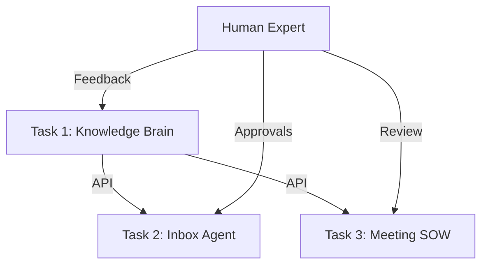

# DESIGN.md - AI Tech Consultant

## The Problem
Software development costs have plummeted, but the surrounding consultation—understanding the product, managing communication, and scoping work—remains human-intensive and expensive. To scale 10-20x, we must automate these high-friction tasks with an integrated AI system.

## System Architecture
The system is built as three decoupled services communicating via APIs:

### Task 1: Knowledge Brain (Python)
- **Scraper**: A polite, sitemap-aware crawler for Brilliant Directories.
- **Memory**: Hybrid RAG using keyword indexing and Claude-3.5-Sonnet for contextual retrieval.
- **Multimodal**: Uses Claude's vision capabilities to interpret screenshots in help articles.

### Task 2: Inbox Agent (TypeScript)
- **Triage**: Categorizes incoming emails.
- **Drafting**: Calls KB API to fetch technical facts.
- **Learning Loop**: Tracks human edits to drafts.
- **Auto-Pilot**: Uses a "20-streak" mechanism to unlock autonomous replies for stable categories.

### Task 3: Meeting to SOW (Python)
- **Agent Team**: 
    - *Senior Consultant*: Extracts business requirements.
    - *Technical Architect*: Queries KB API to differentiate between built-in settings and custom code.
    - *Estimator*: Generates task-level hour estimates.
- **Diffing Engine**: Compares follow-up meeting transcripts against previous SOWs to highlight changes.

## Model Choices
- **Claude 3.5 Sonnet**: Used for complex reasoning, SOW generation, and technical support answers. Chosen for its superior coding and technical reasoning.
- **Claude 3.5 Haiku**: (Optional) Used for quick triage and simple drafting to reduce latency and cost.

## What Breaks & Next Steps
- **Breaks**: Extremely long transcripts might exceed context windows; very complex CSS/JS customizations might need deeper code analysis.
- **Next**: Implement a dedicated Vector DB (e.g., Pinecone or Qdrant) for faster scaling of the Knowledge Brain.
